# Laboratório AWS — Amazon EC2


Laboratório prático dedicado ao provisionamento, gerenciamento, monitoramento e redimensionamento de uma instância **Amazon EC2**.

A atividade é executada em um ambiente educacional temporário disponibilizado pela **Escola da Nuvem**, utilizando o Console de Gerenciamento da AWS.

---

## 1. Visão geral

O **Amazon Elastic Compute Cloud (Amazon EC2)** fornece capacidade computacional redimensionável na nuvem.

O serviço permite provisionar servidores virtuais em poucos minutos e ajustar a capacidade computacional conforme as necessidades do ambiente ou da aplicação.

Durante este laboratório serão exploradas operações relacionadas ao ciclo de vida de uma instância EC2, incluindo criação, configuração de segurança, monitoramento, acesso a uma aplicação web, redimensionamento e encerramento.

### Arquitetura conceitual

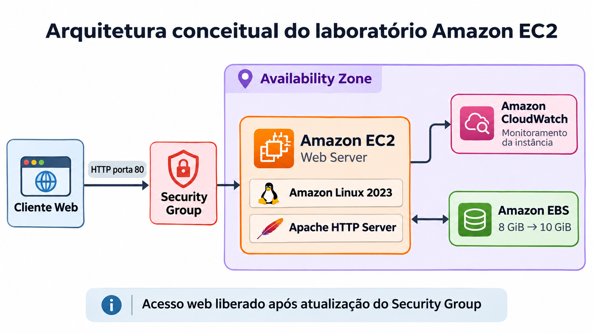

A arquitetura abaixo representa, de forma simplificada, o ambiente utilizado durante o laboratório:

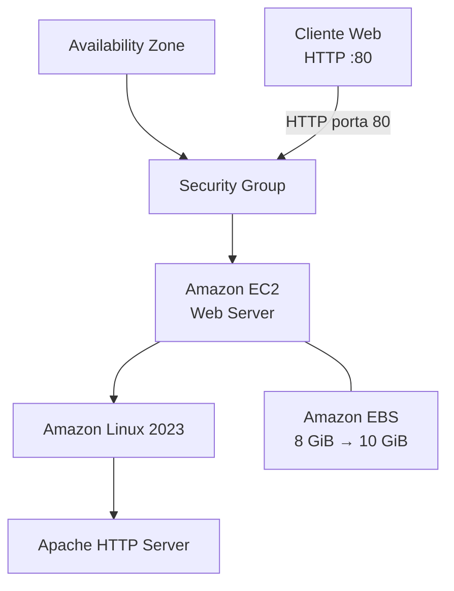

A arquitetura contempla:

- uma instância Amazon EC2;
- execução dentro de uma Availability Zone;
- proteção de rede por meio de um Security Group;
- Amazon Linux 2023 como sistema operacional;
- Apache HTTP Server como servidor web;
- Amazon EBS como armazenamento da instância;
- acesso HTTP pela porta 80 após a atualização do Security Group.

O Security Group funciona como uma camada de controle de tráfego da instância, definindo quais conexões de entrada e saída são permitidas.

> Observação: o diagrama introdutório do material didático identifica o servidor como `IIS Web Server`. Entretanto, a execução prática deste laboratório utiliza **Amazon Linux 2023 com Apache HTTP Server**, conforme definido nas instruções da atividade.

### Duração estimada

A duração prevista do laboratório é de aproximadamente **45 minutos**.

---

## 2. Objetivos de aprendizagem

Ao final do laboratório, pretendo ser capaz de:

- iniciar um servidor web em uma instância EC2 com proteção contra encerramento;
- monitorar uma instância Amazon EC2;
- modificar um Security Group para permitir acesso HTTP;
- acessar uma aplicação web hospedada na instância;
- redimensionar uma instância EC2 conforme a necessidade;
- ampliar o armazenamento Amazon EBS;
- testar a proteção contra encerramento;
- encerrar corretamente a instância utilizada.

---

## 3. Tecnologias utilizadas

| Tecnologia | Utilização |
| --- | --- |
| Amazon EC2 | Provisionamento e gerenciamento da instância virtual |
| Amazon Linux 2023 | Sistema operacional da instância |
| Amazon VPC | Rede virtual utilizada pelo laboratório |
| Security Groups | Controle do tráfego de rede |
| Amazon EBS | Armazenamento em bloco da instância |
| Apache HTTP Server | Servidor web utilizado na atividade |
| Bash | Automação da configuração inicial |
| EC2 User Data | Execução automática do script de inicialização |
| Amazon CloudWatch | Monitoramento e métricas da instância |

---

## 4. Etapas do laboratório

A atividade é dividida em cinco tarefas principais.

### Tarefa 1 — Iniciar a instância EC2

- criar a instância `Web Server`;
- utilizar Amazon Linux 2023;
- selecionar inicialmente o tipo `t3.micro`;
- configurar rede e Security Group;
- utilizar volume Amazon EBS;
- habilitar proteção contra encerramento;
- executar o script de User Data;
- aguardar a aprovação das verificações de status.

### Tarefa 2 — Monitorar a instância

- analisar as verificações de status;
- consultar métricas de monitoramento;
- explorar recursos de diagnóstico da instância.

### Tarefa 3 — Atualizar o Security Group

- testar inicialmente o acesso ao servidor web;
- identificar o bloqueio da porta HTTP;
- adicionar uma regra de entrada para a porta 80;
- validar o funcionamento da página web.

### Tarefa 4 — Redimensionar a instância

- interromper a instância;
- alterar o tipo de `t3.micro` para `t3.small`;
- aumentar o volume EBS de `8 GiB` para `10 GiB`;
- iniciar novamente a instância.

### Tarefa 5 — Testar a proteção contra encerramento

- tentar encerrar a instância com a proteção habilitada;
- validar o bloqueio do encerramento;
- desabilitar a proteção;
- encerrar corretamente a instância.

---

## 5. Configuração planejada

| Configuração | Valor |
| --- | --- |
| Nome da instância | `Web Server` |
| AMI | Amazon Linux 2023 |
| Tipo inicial | `t3.micro` |
| Tipo após redimensionamento | `t3.small` |
| Par de chaves | Não utilizado |
| VPC | Lab VPC fornecida pelo ambiente |
| Security Group | `Web Server security group` |
| Volume inicial | `8 GiB` |
| Volume final | `10 GiB` |
| Proteção contra encerramento | Habilitada inicialmente |
| Servidor web | Apache HTTP Server |
| Automação | EC2 User Data |

---

## 6. Automação com EC2 User Data

O script armazenado em [`scripts/user-data.sh`](./scripts/user-data.sh) será utilizado durante a criação da instância.

A implementação foi personalizada para este projeto, mantendo todos os requisitos funcionais definidos pelo laboratório.

O script realiza automaticamente:

- instalação do Apache HTTP Server;
- habilitação do Apache durante a inicialização;
- inicialização do serviço `httpd`;
- criação da página `/var/www/html/index.html`;
- publicação de uma página web personalizada do AWS Lab.

A página mantém a mensagem **Hello From Your Web Server!**, utilizada na validação original da atividade, mas adiciona uma apresentação visual própria do projeto.

### Resultado esperado

Após a liberação da porta HTTP no Security Group, o servidor deverá apresentar:

- identificação do laboratório Amazon EC2;
- confirmação de uso do Amazon Linux 2023;
- confirmação do Apache HTTP Server;
- status `Web Server Online`;
- identificação Souzas Dev.

O código completo permanece versionado separadamente para facilitar manutenção, reutilização e auditoria.

---

## 7. Evidências

As evidências são registradas durante a execução e organizadas por tarefa.

### Evidências da Tarefa 1 — Iniciar a instância EC2

A primeira tarefa foi concluída com sucesso.

Durante a execução, configurei:

- instância `Web Server`;
- tags para identificação do projeto;
- Amazon Linux 2023;
- tipo de instância `t3.micro`;
- execução sem par de chaves;
- `Lab VPC`;
- Security Group sem regras de entrada;
- volume raiz Amazon EBS `gp3` de `8 GiB`;
- proteção contra encerramento;
- User Data personalizado para instalação e configuração do Apache HTTP Server.

Após o provisionamento, a instância atingiu o estado **Em execução** e apresentou **3/3 verificações de status aprovadas**.

> O material do laboratório menciona 2/2 verificações. Durante a execução prática, o Console da AWS apresentou 3/3 verificações aprovadas; por isso, a documentação registra o resultado efetivamente observado.

#### Principais evidências

##### Nome e identificação do projeto

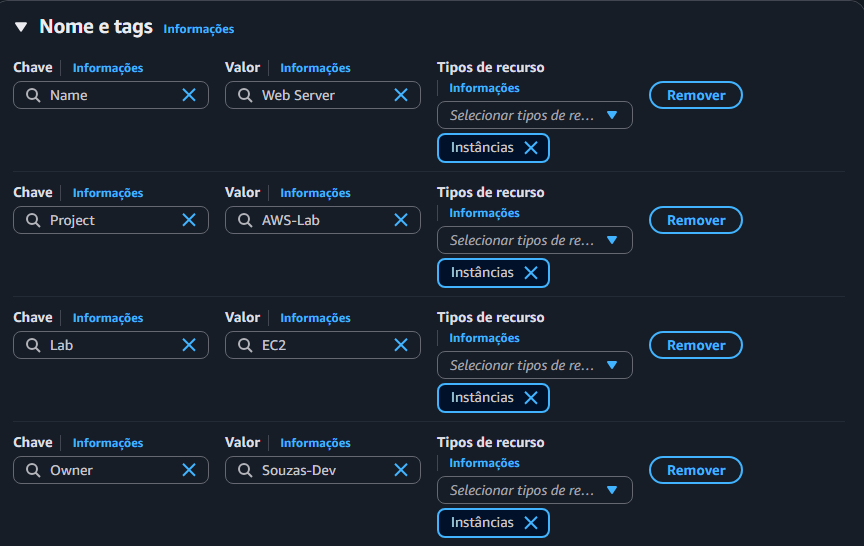

##### Amazon Linux 2023

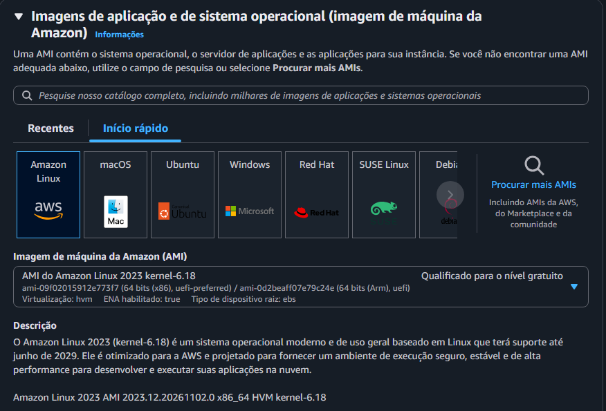

##### Tipo de instância t3.micro

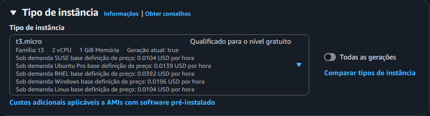

##### VPC e Security Group

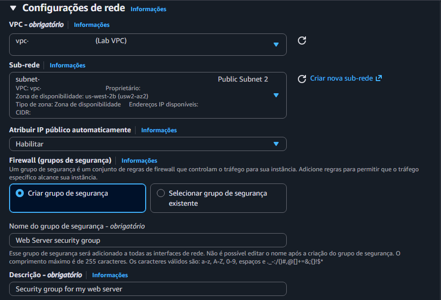

##### Amazon EBS — 8 GiB

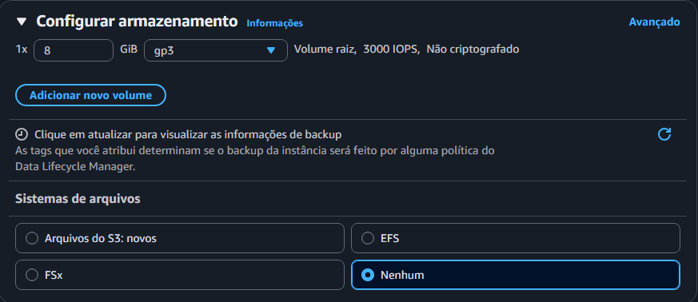

##### Proteção contra encerramento

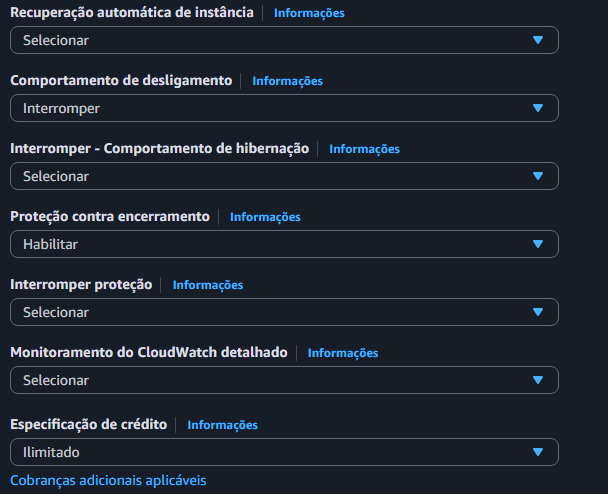

##### User Data personalizado

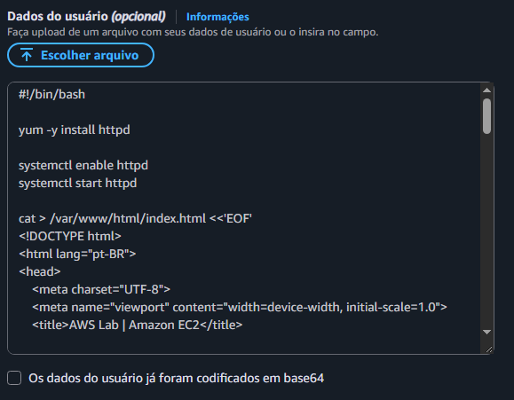

##### Instância criada com sucesso

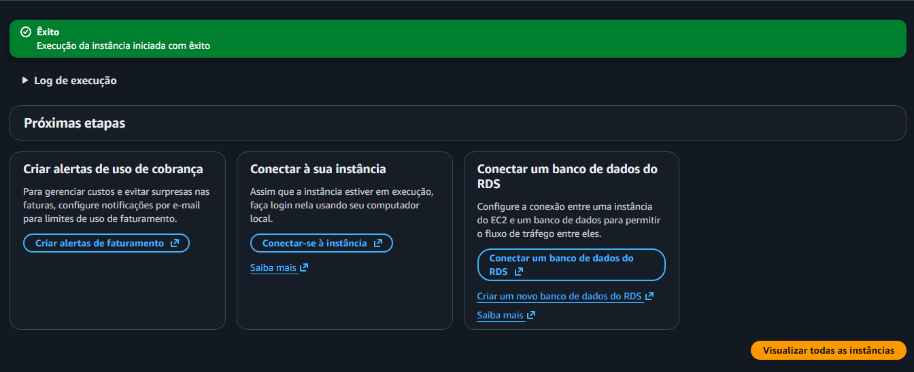

##### Verificações de status

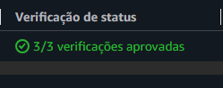

O conjunto completo com as **21 capturas da Tarefa 1** está disponível em [`evidencias/tarefa-01/`](./evidencias/tarefa-01/).

As capturas destinadas à publicação foram revisadas e identificadores sensíveis foram ocultados.

---

## 8. Controle de custos

O Amazon EC2 utiliza um modelo em que o consumo de recursos influencia diretamente o custo do ambiente.

Embora este laboratório seja executado em um ambiente educacional temporário, também serão analisados os principais componentes que poderiam gerar custos em uma conta AWS real.

[Acessar o controle de custos do laboratório](./docs/controle-de-custos.md)

---

## 9. Estrutura do laboratório

```text
EC2/
|-- README.md
|-- assets/
|   `-- arquitetura-conceitual-ec2.png
|-- docs/
|   `-- controle-de-custos.md
|-- evidencias/
|   |-- custos/
|   |-- tarefa-01/
|   |-- tarefa-02/
|   |-- tarefa-03/
|   |-- tarefa-04/
|   `-- tarefa-05/
`-- scripts/
    `-- user-data.sh
```

---

## 10. Segurança e boas práticas

Durante a documentação do laboratório serão observadas práticas como:

- não publicar credenciais;
- não armazenar Access Keys ou Secret Access Keys;
- revisar identificadores presentes nas capturas de tela;
- utilizar Security Groups para controlar o tráfego;
- remover recursos temporários ao final das atividades;
- registrar problemas e soluções encontrados durante a execução.

---

## 11. Status

Em andamento.

---

## 12. Conclusão

Esta seção será atualizada após a conclusão integral do laboratório, registrando os resultados, desafios encontrados e principais aprendizados.
