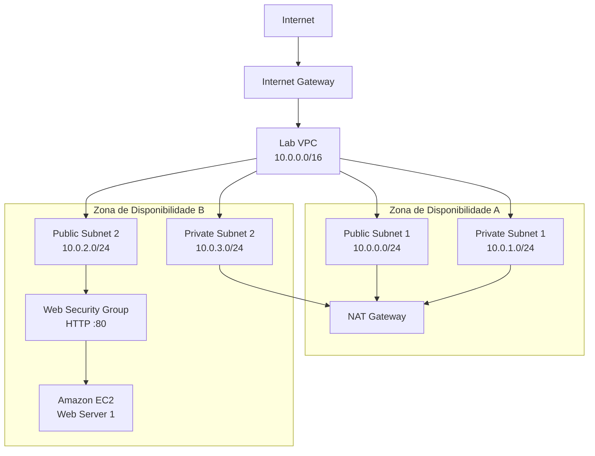

# Laboratório AWS — Amazon VPC e Servidor Web


Laboratório prático dedicado à construção de uma infraestrutura de rede personalizada utilizando **Amazon Virtual Private Cloud (Amazon VPC)** e ao provisionamento de uma instância **Amazon EC2** configurada como servidor web.

A atividade é executada em um ambiente educacional temporário e documentada como parte do projeto **AWS Lab**, reunindo arquitetura, configurações, evidências, testes e aprendizados obtidos durante a execução.

---

## 1. Visão geral

O **Amazon Virtual Private Cloud (Amazon VPC)** permite criar redes virtuais logicamente isoladas dentro da infraestrutura da AWS.

Neste laboratório, construirei uma VPC com sub-redes públicas e privadas distribuídas entre duas Zonas de Disponibilidade.

A arquitetura também utilizará recursos de roteamento e segurança para permitir comunicação entre os componentes da rede e fornecer acesso à Internet quando necessário.

Ao final da atividade, uma instância Amazon EC2 será provisionada dentro da nova VPC e configurada para executar um servidor web.

### Arquitetura planejada



A versão gráfica autoral da arquitetura será adicionada posteriormente em:

`assets/arquitetura-conceitual-vpc.png`

### Duração estimada

A duração prevista do laboratório é de aproximadamente **45 minutos**.

---

## 2. Objetivos de aprendizagem

Os objetivos deste laboratório são:

- criar uma Amazon VPC;
- criar sub-redes públicas e privadas;
- compreender a distribuição de recursos entre Zonas de Disponibilidade;
- configurar um Internet Gateway;
- utilizar um NAT Gateway;
- configurar tabelas de rotas públicas e privadas;
- associar sub-redes às tabelas de rotas correspondentes;
- criar um Security Group;
- permitir acesso HTTP ao servidor web;
- provisionar uma instância Amazon EC2 dentro da nova VPC;
- configurar automaticamente um servidor web;
- validar o acesso à aplicação pela Internet;
- documentar a arquitetura e as configurações utilizadas.

---

## 3. Tecnologias e serviços utilizados

| Tecnologia / Serviço | Utilização |
| --- | --- |
| Amazon VPC | Criação da rede virtual |
| Subnets | Segmentação da rede |
| Internet Gateway | Comunicação entre a VPC e a Internet |
| NAT Gateway | Acesso externo para recursos em redes privadas |
| Route Tables | Controle do roteamento da VPC |
| Security Groups | Firewall virtual da instância |
| Amazon EC2 | Hospedagem do servidor web |
| Amazon Linux 2 | Sistema operacional previsto para a instância |
| Apache HTTP Server | Servidor web |
| PHP | Componente utilizado pela aplicação do laboratório |
| Bash | Automação da configuração inicial |
| EC2 User Data | Execução automática do provisionamento |
| AWS Management Console | Criação e gerenciamento dos recursos |
| PowerShell | Organização e versionamento local do projeto |
| Git e GitHub | Controle de versão e publicação da documentação |

---

## 4. Planejamento de rede

A VPC utilizará o bloco CIDR:

`10.0.0.0/16`

A rede será dividida em quatro sub-redes.

| Sub-rede | CIDR | Tipo | Zona |
| --- | --- | --- | --- |
| Public Subnet 1 | `10.0.0.0/24` | Pública | Zona de Disponibilidade A |
| Private Subnet 1 | `10.0.1.0/24` | Privada | Zona de Disponibilidade A |
| Public Subnet 2 | `10.0.2.0/24` | Pública | Zona de Disponibilidade B |
| Private Subnet 2 | `10.0.3.0/24` | Privada | Zona de Disponibilidade B |

### Tabela de rotas pública

A tabela pública deverá possuir uma rota para a Internet.

| Destino | Alvo |
| --- | --- |
| `10.0.0.0/16` | local |
| `0.0.0.0/0` | Internet Gateway |

### Tabela de rotas privada

A tabela privada utilizará o NAT Gateway para acesso externo.

| Destino | Alvo |
| --- | --- |
| `10.0.0.0/16` | local |
| `0.0.0.0/0` | NAT Gateway |

---

## 5. Etapas do laboratório

A atividade está organizada em cinco tarefas principais.

### Tarefa 1 — Criar a VPC

Nesta etapa será utilizada a criação de **VPC e muito mais** para provisionar a estrutura inicial.

Configurações previstas:

| Configuração | Valor |
| --- | --- |
| Nome da VPC | `Lab VPC` |
| IPv4 CIDR | `10.0.0.0/16` |
| IPv6 | Não utilizado |
| Tenancy | Padrão |
| Zonas de Disponibilidade | 1 inicialmente |
| Sub-redes públicas | 1 |
| Sub-redes privadas | 1 |
| Public Subnet 1 | `10.0.0.0/24` |
| Private Subnet 1 | `10.0.1.0/24` |
| NAT Gateway | 1 AZ |
| VPC Endpoints | Nenhum |
| Public Route Table | `Public Route Table` |
| Private Route Table | `Private Route Table` |

O assistente também criará os componentes necessários para conectar a VPC à Internet.

### Tarefa 2 — Criar sub-redes adicionais

Nesta etapa serão adicionadas duas novas sub-redes para ampliar a arquitetura para uma segunda Zona de Disponibilidade.

| Nome | CIDR | Tipo |
| --- | --- | --- |
| `Public Subnet 2` | `10.0.2.0/24` | Pública |
| `Private Subnet 2` | `10.0.3.0/24` | Privada |

A distribuição em múltiplas Zonas de Disponibilidade permite compreender conceitos relacionados à disponibilidade e organização de recursos de rede.

### Tarefa 3 — Associar sub-redes e configurar o roteamento

Nesta etapa serão realizadas as associações entre as novas sub-redes e as tabelas de rotas.

Planejamento:

- associar `Public Subnet 2` à `Public Route Table`;
- associar `Private Subnet 2` à `Private Route Table`;
- validar as associações existentes;
- conferir as rotas utilizadas pelas redes públicas;
- conferir as rotas utilizadas pelas redes privadas.

Ao final da tarefa, a VPC deverá possuir duas sub-redes públicas e duas privadas organizadas entre duas Zonas de Disponibilidade.

### Tarefa 4 — Criar o Security Group

Será criado um Security Group para proteger a instância do servidor web.

| Configuração | Valor |
| --- | --- |
| Nome | `Web Security Group` |
| Descrição | `Enable HTTP access` |
| VPC | `Lab VPC` |
| Tipo de entrada | HTTP |
| Protocolo | TCP |
| Porta | `80` |
| Origem | `0.0.0.0/0` |
| Descrição da regra | `Permit web requests` |

A regra permitirá que clientes externos acessem a aplicação web hospedada na instância EC2.

### Tarefa 5 — Iniciar uma instância de servidor web

Na última tarefa será provisionada uma instância Amazon EC2 dentro da nova VPC.

Configurações previstas:

| Configuração | Valor |
| --- | --- |
| Nome | `Web Server 1` |
| Sistema operacional | Amazon Linux 2 |
| Tipo de instância | `t3.micro` |
| Par de chaves | `vockey` |
| VPC | `Lab VPC` |
| Sub-rede | Sub-rede pública |
| IPv4 público automático | Habilitado |
| Security Group | `Web Security Group` |
| Servidor web | Apache HTTP Server |
| Automação | EC2 User Data |

Depois do provisionamento, serão verificadas as verificações de status da instância e o endereço DNS público será utilizado para validar a aplicação web.

---

## 6. Automação com EC2 User Data

O laboratório utiliza um script Bash executado durante a inicialização da instância.

O script será armazenado em:

[`scripts/user-data.sh`](./scripts/user-data.sh)

Sua função será:

- instalar o Apache HTTP Server;
- instalar os componentes adicionais utilizados pela aplicação;
- baixar os arquivos da aplicação;
- extrair os arquivos para `/var/www/html/`;
- habilitar o servidor web durante a inicialização;
- iniciar o serviço HTTP.

O arquivo será criado e validado localmente antes da execução da Tarefa 5.

---

## 7. Evidências

As evidências serão organizadas de acordo com cada tarefa.

### Evidências da Tarefa 1 — Criar a VPC

Diretório:

`evidencias/tarefa-01/`

Evidências previstas:

- configuração do CIDR da VPC;
- configuração das sub-redes iniciais;
- configuração do NAT Gateway;
- nomes dos recursos;
- criação bem-sucedida da `Lab VPC`;
- visualização final dos recursos criados.

### Evidências da Tarefa 2 — Criar sub-redes adicionais

Diretório:

`evidencias/tarefa-02/`

Evidências previstas:

- criação da `Public Subnet 2`;
- criação da `Private Subnet 2`;
- CIDRs configurados;
- visualização das quatro sub-redes.

### Evidências da Tarefa 3 — Associar sub-redes e configurar o roteamento

Diretório:

`evidencias/tarefa-03/`

Evidências previstas:

- associação da `Public Subnet 2`;
- associação da `Private Subnet 2`;
- tabela de rotas pública;
- tabela de rotas privada;
- validação final das associações.

### Evidências da Tarefa 4 — Criar o Security Group

Diretório:

`evidencias/tarefa-04/`

Evidências previstas:

- criação do `Web Security Group`;
- regra HTTP na porta 80;
- associação com a `Lab VPC`;
- resultado final do Security Group.

### Evidências da Tarefa 5 — Iniciar uma instância de servidor web

Diretório:

`evidencias/tarefa-05/`

Evidências previstas:

- configuração da instância;
- seleção da VPC e sub-rede;
- associação do Security Group;
- configuração do User Data;
- instância em execução;
- verificações de status;
- DNS IPv4 público;
- aplicação web funcionando no navegador.

As capturas destinadas ao repositório serão revisadas antes da publicação para evitar a exposição de informações desnecessárias ou sensíveis.

---

## 8. Controle de custos

A arquitetura utiliza recursos que, em uma conta AWS convencional, podem possuir custos associados.

Entre os principais pontos estão:

- execução da instância Amazon EC2;
- armazenamento associado à instância;
- endereço IPv4 público;
- transferência de dados;
- NAT Gateway;
- processamento de dados pelo NAT Gateway.

O laboratório é executado em um ambiente educacional temporário, mas os recursos serão analisados também sob a perspectiva de utilização em uma conta AWS própria.

A análise será registrada em:

[`docs/controle-de-custos.md`](./docs/controle-de-custos.md)

---

## 9. Estrutura do laboratório

```text
VPC/
|-- README.md
|-- assets/
|   `-- arquitetura-conceitual-vpc.png
|-- docs/
|   `-- controle-de-custos.md
|-- evidencias/
|   |-- tarefa-01/
|   |-- tarefa-02/
|   |-- tarefa-03/
|   |-- tarefa-04/
|   `-- tarefa-05/
`-- scripts/
    `-- user-data.sh
```

A estrutura será preenchida progressivamente durante a execução.

---

## 10. Segurança e boas práticas

As práticas adotadas incluem:

- não publicar credenciais AWS;
- não armazenar Access Keys ou Secret Access Keys;
- não versionar tokens ou informações de autenticação;
- revisar identificadores presentes nas capturas;
- utilizar Security Groups para limitar o tráfego necessário;
- manter redes públicas e privadas logicamente separadas;
- documentar alterações de roteamento;
- evitar alterações fora do escopo do laboratório;
- remover ou encerrar recursos quando previsto pelo ambiente;
- registrar problemas e soluções encontrados durante a execução.

O acesso HTTP público é utilizado especificamente para permitir a validação do servidor web solicitada pelo laboratório.

---

## 11. Status

**Em andamento.**

A estrutura local do projeto foi criada e o laboratório foi analisado antes da execução dos recursos no Console AWS.

As cinco tarefas práticas ainda serão executadas e documentadas individualmente.

---

## 12. Aprendizados

Esta seção será preenchida progressivamente durante a execução.

Os principais tópicos a serem avaliados incluem:

- planejamento de endereçamento CIDR;
- diferença entre sub-redes públicas e privadas;
- funcionamento de Internet Gateway;
- funcionamento de NAT Gateway;
- tabelas de rotas;
- distribuição entre Zonas de Disponibilidade;
- controle de tráfego com Security Groups;
- integração entre Amazon VPC e Amazon EC2;
- publicação de aplicações web em infraestrutura AWS.

---

## 13. Conclusão

Esta seção será finalizada após a execução das cinco tarefas, validação do servidor web e encerramento do laboratório.
