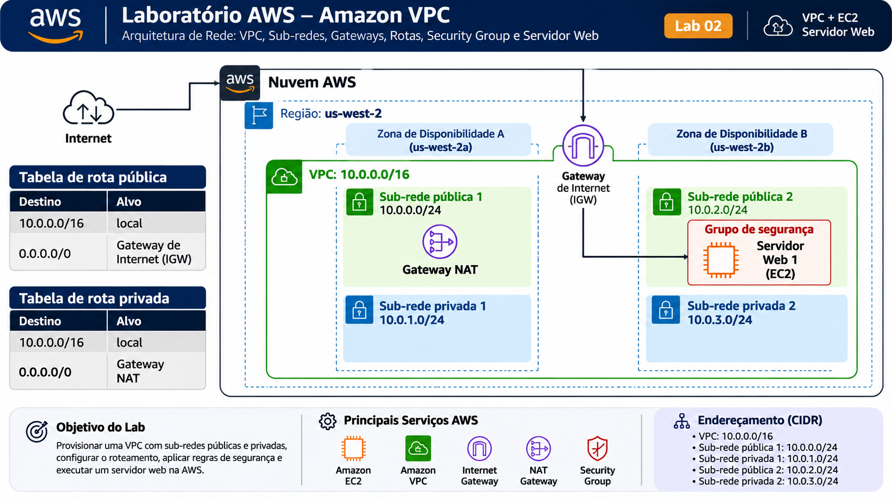

# Lab 02 — Amazon VPC e Servidor Web

Laboratório prático AWS Lab 267, documentado no portfólio [AWS-Lab](../README.md).

**Status:** cinco tarefas documentadas, aplicação HTTP validada visualmente e instância EC2 encerrada. Algumas validações de infraestrutura e limpeza permanecem pendentes.

## 1. Objetivo

Construir uma Amazon VPC personalizada, configurar sub-redes públicas e privadas, associar tabelas de rotas, criar um Security Group e hospedar uma aplicação web em Amazon EC2.

## 2. Arquitetura

O diagrama apresenta a arquitetura planejada no roteiro institucional. Não representa uma comprovação integral de disponibilidade multi-AZ.

### Configuração de rede

**VPC:** Lab VPC

**CIDR:** `10.0.0.0/16`

**Região do laboratório:** `us-west-2` (Oregon)

| Sub-rede | CIDR | Associação confirmada |
| --- | --- | --- |
| Public Subnet 1 | `10.0.0.0/24` | Public Route Table |
| Private Subnet 1 | `10.0.1.0/24` | Private Route Table |
| Public Subnet 2 | `10.0.2.0/24` | Public Route Table |
| Private Subnet 2 | `10.0.3.0/24` | Private Route Table |

O provisionamento inicial registrou a criação de Internet Gateway e NAT Gateway. As associações das quatro sub-redes foram comprovadas.

As entradas efetivas das tabelas de rotas, incluindo os alvos dos gateways, não foram verificadas diretamente nas capturas.

### Limitação de disponibilidade

As sub-redes iniciais foram configuradas em `us-west-2a`.

A `Public Subnet 2`, utilizada pela instância EC2, também aparece em `us-west-2a`.

A AZ da `Private Subnet 2` não foi confirmada.

Portanto, a distribuição planejada entre duas Zonas de Disponibilidade não foi integralmente comprovada.

## 3. Documentação por tarefa

| Tarefa | Documento técnico | Evidências | PR |
| --- | --- | ---: | --- |
| 01 — Criar VPC | [Tarefa 01](./docs/tarefa-01-criacao-vpc.md) | 13 | [#2](https://github.com/Souzas-Dev/AWS-Lab/pull/2) |
| 02 — Criar sub-redes | [Tarefa 02](./docs/tarefa-02-criacao-sub-redes.md) | 4 | [#3](https://github.com/Souzas-Dev/AWS-Lab/pull/3) |
| 03 — Associar rotas | [Tarefa 03](./docs/tarefa-03-roteamento.md) | 9 | [#4](https://github.com/Souzas-Dev/AWS-Lab/pull/4) |
| 04 — Security Group | [Tarefa 04](./docs/tarefa-04-security-group.md) | 6 | [#5](https://github.com/Souzas-Dev/AWS-Lab/pull/5) |
| 05 — Servidor Web | [Tarefa 05](./docs/tarefa-05-servidor-web.md) | 15 | [#6](https://github.com/Souzas-Dev/AWS-Lab/pull/6) |

**Total:** 47 capturas de evidências revisadas.

## 4. Servidor Web EC2

| Configuração | Resultado observado |
| --- | --- |
| Nome | Web Server 1 |
| AMI selecionada | Amazon Linux 2023 |
| Tipo | `t3.micro` |
| Par de chaves | `vockey` |
| VPC | Lab VPC |
| Sub-rede | Public Subnet 2 |
| Zona de Disponibilidade | `us-west-2a` |
| IP público | Atribuído |
| Security Group | Web Security Group |
| Porta HTTP | TCP 80 |
| Origem HTTP | `0.0.0.0/0` |
| Verificações EC2 | 3/3 aprovadas |
| Estado final | Encerrado |

O primeiro acesso à aplicação apresentou timeout. Uma tentativa posterior carregou a aplicação institucional via HTTP.

O código exato da resposta HTTP e a causa do timeout não foram registrados.

## 5. Automação

O roteiro institucional original utilizava Amazon Linux 2.

Foi preparado um [script User Data](./scripts/user-data.sh) para Amazon Linux 2023 utilizando DNF e systemctl.

O script contempla:

- atualização dos pacotes;
- instalação de Apache, PHP, wget e unzip;
- download da aplicação institucional;
- extração em `/var/www/html`;
- configuração de permissões;
- inicialização do Apache.

O trecho visível no Console AWS coincide com a parte correspondente do arquivo local. A execução integral do script não foi conferida diretamente por logs do cloud-init.

## 6. Evidências

As imagens revisadas estão disponíveis nos diretórios:

- [Tarefa 01](./evidencias/tarefa-01/)
- [Tarefa 02](./evidencias/tarefa-02/)
- [Tarefa 03](./evidencias/tarefa-03/)
- [Tarefa 04](./evidencias/tarefa-04/)
- [Tarefa 05](./evidencias/tarefa-05/)

As capturas publicadas foram revisadas para ocultar identificadores e dados sensíveis desnecessários.

## 7. Custos e segurança

Recursos como NAT Gateway, IPv4 público, EC2, EBS e transferência de dados podem gerar cobranças em contas AWS convencionais.

A instância EC2 foi encerrada, mas não há comprovação da exclusão completa dos demais recursos da VPC.

[Consultar controle de custos e checklist de encerramento](./docs/controle-de-custos.md).

## 8. Validações pendentes

- Destinos e alvos efetivos das rotas públicas e privadas.
- AZ atribuída à Private Subnet 2.
- Distribuição real dos recursos entre duas AZs.
- Execução integral do User Data e logs do cloud-init.
- Código de status HTTP e diagnóstico do timeout.
- Regra de saída salva no Security Group.
- Auditoria de recursos residuais e custos.

## 9. Aprendizados

O laboratório permitiu praticar endereçamento CIDR, sub-redes, roteamento, grupos de segurança, EC2, automação com User Data, publicação HTTP e ciclo de vida de instâncias.

Também demonstrou a importância de distinguir arquitetura planejada, configuração observada e validação efetivamente comprovada.

## 10. Conclusão

As cinco tarefas foram documentadas em Pull Requests separados.

A aplicação web foi acessada e a instância EC2 foi encerrada.

**Documentação concluída, com limitações técnicas explicitadas.**

O encerramento financeiro e a remoção completa da infraestrutura não foram confirmados.
